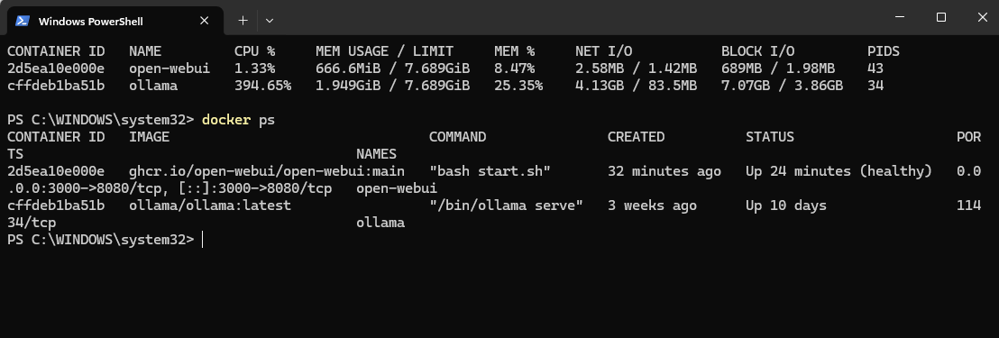

# local-ai-server-noble
Self-hosted local AI server using Docker, Ollama, Open WebUI, Qwen3, and Tailscale for secure remote access.

# Noble Local AI Server

A self-hosted local AI server built with Docker, Ollama, Open WebUI, Qwen3 1.7B, and Tailscale.

This project was created to explore local AI deployment, containerization, remote access, Docker networking, and lightweight model hosting on limited hardware.

## Overview

The server runs a local AI assistant named **Noble** using the **Qwen3 1.7B** model through Ollama.

Open WebUI provides the browser-based interface, Docker manages the application stack, and Tailscale provides remote access without requiring direct public port forwarding.

## Architecture

```text
Remote Device
     |
     v
  Tailscale
     |
     v
 Open WebUI
     |
     v
   Ollama
     |
     v
Noble / Qwen3 1.7B
```

## Technologies

- Docker
- Ollama
- Open WebUI
- Qwen3 1.7B
- Tailscale
- Windows 11
- PowerShell

## Features

- Locally hosted AI inference
- Custom Ollama model named **Noble**
- Browser-based chat interface through Open WebUI
- Docker containerization
- Persistent Docker storage
- Remote access through Tailscale
- Local model execution without relying on a hosted inference API
- Lightweight deployment designed around limited hardware resources

## Screenshots

### Noble Interface


### Noble Local AI Demo


### Docker Stack and Resource Usage



### Tailscale Remote Access


## Noble Modelfile

Noble was created using an Ollama Modelfile based on Qwen3 1.7B.

```text
FROM qwen3:1.7b

SYSTEM You are Noble, a helpful local AI assistant.
```

The `Modelfile` used for the project is included in this repository.

## Hardware

The server runs on a repurposed HP all-in-one computer with approximately 8 GB of usable memory.

Several model sizes were tested. Qwen3 1.7B was selected because it provided a better balance between response quality, memory usage, and performance on the available hardware.

## What I Learned

This project provided hands-on experience with:

- Deploying local large language models
- Docker containers and persistent volumes
- Docker networking and troubleshooting
- Ollama model management
- Open WebUI configuration
- Remote networking with Tailscale
- Monitoring CPU and memory usage during local inference
- Troubleshooting service connectivity between containers

## Security

Remote access is handled through Tailscale rather than exposing the AI server directly through traditional router port forwarding.

Sensitive information such as authentication credentials, network identifiers, private URLs, and access tokens are not included in this repository.
